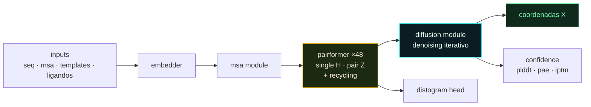
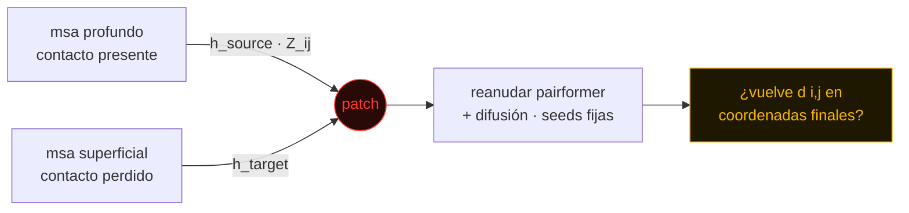

<Cover
  title="AlphaFold3"
  :status="['Interpretabilidad', 'JAX', 'Patching']"
  :sub="['mecanismos causales', 'activation patching', 'geometría 3D']"
  author="Emilio Bardan · tsesis · 2026"
/>

<!--
Basado en el field assessment del 14 oct 2026 (assessment.pdf).
-->

---
class: theme-frieren layer-solarpunk
---

# la tesis en una frase

<Slashes :items="['af3 congelado', 'una feature', 'coordenadas finales']" />

usar <b>activation patching</b> sobre un <b>alphafold 3 congelado</b> para conectar
<b>una feature o vía interna</b> con un <b>cambio selectivo y reproducible</b>
en las coordenadas 3d generadas por difusión.

  
selectivo cambia la propiedad objetivo · el resto de la estructura se preserva

  
reproducible se sostiene entre seeds, controles pareados y proteínas held-out

<!--
El assessment lo identifica como la oportunidad abierta más fuerte en MI de predictores de estructura (p.5).
-->

---
class: theme-lain layer-cyberpunk
---

# decisiones

<Slashes :items="['modelo', 'método', 'endpoint', 'claim']" />

  
modeloalphafold 3 · jax/haiku · pesos congelados

  
métodoactivation patching + ablación / rescate

  
endpointcoordenadas finales del módulo de difusión — no una lectura intermedia

  
claimcausal sobre el output → idealmente mecanístico (circuito / vía)

  
entrenamientoninguno · sólo forward passes

---
class: theme-eva layer-cyberpunk
---

# el gap

<Slashes :items="['trabajo previo', 'qué falta']" />

| trabajo | qué mostró | qué **no** mostró |
|---|---|---|
| **alphainterp** · feldman & skolnick 2026 · af3 | probes en single/pair en 4 ubicaciones; edits pca del pair final cambian la entropía del distograma | efecto en el **distogram head**, no en coordenadas de difusión |
| **pair scaling** · suzuki & amagasa 2026 · af3 + boltz-2 | escalar el pair rep amplía el sampling y recupera estados alternativos (86 proteínas) | perilla **global** — edita todas las features a la vez |
| **pairsae** · migliorini et al. 2026 · boltz-2 | sae sobre pair comprimido; features alineadas con anotaciones | sin intervenciones · sin msas |
| **saefold** · parsan et al. 2025 · esmfold | edit sae aumenta accesibilidad al solvente | ¿estado válido o daño / desorden? |
| interplm · adams et al. · esm-2 | features interpretables en plms | sobre el lenguaje, no el plegador |

→ el descubrimiento de features está más maduro que la explicación a nivel circuito.
la contribución: explicar un efecto selectivo <b>y su transmisión</b>, con held-out y controles.

---
class: theme-lain layer-vaporwave
---

# pipeline af3

<Slashes :items="['trunk', 'difusión', 'heads']" />

recycling y pasos de difusión = cómputo del modelo, no tiempo físico de plegamiento.
recycles / pasos / samples por seed se leen del config instalado — no se asumen.

---
class: theme-frieren layer-solarpunk
---

# representaciones

<Slashes :items="['H', 'Z', 'X']" />

  
single H · N × 384vector contextual por token (residuo; átomos para ligandos)

  
pair Z · N × N × 128vector por par ordenado i→j

  
coords X · A × 3una posición por átomo · A ≠ N

<v-clicks>

- los vectores pair **no son distancias**; una distancia puede ser *decodificable*
- triangle updates combinan i–k y k–j para actualizar i–j
- intervenir = instrumentar haiku: **capturar → modificar → reanudar**

</v-clicks>

<pre class="ascii pt-4">
      j →
    ┌─────────────┐
  i │ · · · · · · │
  ↓ │ · · · · · · │
    │ · · ■ · · · │ ← Z_ij ∈ ℝ¹²⁸
    │ · · · · · · │
    │ · · · · · · │
    └─────────────┘
     N × N × 128
</pre>

---
class: theme-lain layer-cyberpunk
---

# activation patching

<Slashes :items="['capturar', 'modificar', 'reanudar']" />

ver la red como $f(x) = g(h(x))$ · $h$ = activación intermedia · $g$ = resto (incl. difusión)

$$
h' = h_{\text{target}} + m \odot (h_{\text{source}} - h_{\text{target}})
$$

  
m · tokens pares (i, j)

  
m · canales dirección de feature

  
m · capa bloque pairformer

  
m · recycle iteración

  
ablación cero · media · proyectar fuera

  
rescate restaurar tras ablar

  
steering sumar α · dirección

h_source = corrida pareada (misma secuencia, otro msa). fuente, máscara y magnitud <b>son parte de la hipótesis</b>.

---
class: theme-vinland layer-solarpunk
---

# features y evidencia

<Slashes :items="['decodificable', 'causal', 'mecanístico']" />

### candidatos · barato → rico

  canales
  pca
  linear probe · Z_ij
  sae

comparar sae siempre contra baselines neurona / pca / probe.
superposición: un canal ≠ un concepto.

### niveles

  
1 · decodificableun probe lee la propiedad de h — no causal

  
2 · causalintervenir h cambia el output como se predijo

  
3 · mecanísticoexplica cómo se transforma y transmite la información

un mecanismo describe <b>al predictor</b>, no la dinámica real del plegamiento.

---
class: theme-eva layer-cyberpunk
---

仮説

# diseño principal

<Slashes :items="['msa', 'contacto', 'coordenadas']" />

  
pregunta ¿cómo se vuelve la evidencia evolutiva una restricción de contacto?

  
hipótesis una feature localizada en Z_ij media el efecto del msa sobre (i, j) y llega hasta las coordenadas

riesgo principal: la información está <b>distribuida</b> — no existe una feature pequeña y localizada.

---
class: theme-lain layer-vaporwave
---

# protocolo

<Slashes :items="['7 pasos']" />

  
01 · targetsproteínas chicas/medianas, post-cutoff · contacto de largo alcance presente con msa profundo, perdido con msa submuestreado

  
02 · probe¿una dirección en Z_ij predice el contacto entre ejemplos? (nivel 1)

  
03 · patchcopiar la feature (i, j) ± vecindad profundo → superficial, o ablarla · barrer capa y recycle

  
04 · medirdistancia en coordenadas finales · daño off-target · confianza aparte

  
05 · rescaterestaurar la feature y confirmar que la geometría vuelve

  
06 · víapath patching entre capas · triangle updates vs. atención · hasta el condicionamiento de difusión

  
07 · generalizarfamilias held-out · opcional: otro predictor all-atom

---
class: theme-elden layer-solarpunk
---

# controles

<Slashes :items="['no negociables']" />

  
no-change patchh' = h reproduce el baseline bit a bit antes de interpretar nada

  
edits aleatoriosdirección / máscara random de igual norma → descarta daño genérico

  
rescatereversibilidad del efecto

  
pair-scaling globalbaseline a magnitud y budget de samples equivalentes

  
seeds y samplingfijar inputs, seeds, nº samples · top-1 vs. best-of-n

  
off-targetregiones no relacionadas intactas · confianza ≠ geometría

  
sae recon-onlyinsertar sólo la reconstrucción ya puede cambiar outputs

  
leakagefecha posterior ≠ sin homólogos en training

éxito → la explicación predice cuándo funciona, cuándo falla y qué outputs quedan intactos

---
class: theme-frieren layer-cyberpunk
---

# endpoints

<Slashes :items="['geometría', 'distograma', 'confianza']" />

| endpoint | métrica |
|---|---|
| contacto objetivo | $d(i,j)$ Cα/Cβ · $C_{ij} = \mathbb{1}[d(i,j) < \tau]$ · p.ej. Cβ, 8 Å |
| estructura local / global | lddt · tm-score · rmsd |
| daño off-target | Δ lddt / distancias fuera de la región objetivo |
| distograma (vs. alphainterp) | distribución y entropía en (i, j) — reportado aparte |
| confianza | plddt · pae · iptm — confianza, **no** precisión |
| ligandos | posebusters · ligand rmsd · lddt-pli |

diferencias chicas sin barras de error no son resultados.

---
class: theme-lain layer-cyberpunk
---

# cómputo

<Slashes :items="['gpu', 'storage', 'runtime']" />

  
gpu 1× a100/h100 80 gb

  
host 128 gb ram · 16–32 cores

  
scratch 1–2 tb ssd

  
bases af3 ~1 tb → msas cacheados

  
runtime ~62 s · 1.024 tokens

  
piloto 50 × 10 × 3 ≈ 26 gpu-h

<pre class="ascii">
pair tensor  N=512 · 128ch · fp16
  ├─ 1 tensor        64 MiB
  ├─ × 48 capas       3 GiB / recycle
  └─ × 10 recycles   30 GiB / proteína
                     ∝ N²
</pre>

capturar sólo ubicaciones seleccionadas · muestrear pares · streamear.
reutilizar cómputo upstream al parchear tarde.

---
class: theme-vinland layer-solarpunk
---

# estado

<Slashes :items="['hecho', 'siguiente']" />

  
✓ modeloalphafold 3

  
✓ métodoactivation patching

  
✓ diseñomarco y protocolo definidos

  
01 · pesosobtener af3 + revisar términos no comerciales

  
02 · baselineinstalar af3 y correr una predicción

  
03 · hookscapture / patch / resume → pasar el no-change test

  
04 · pilotoproteínas con contactos dependientes del msa

  
05 · perfilmemoria y runtime

  
06 · refinarla hipótesis

---
layout: center
class: theme-elden layer-vaporwave text-center
---

# gracias

"af3 usa la feature x para acercar i y j" 
≠ 
"así se pliega la proteína"

